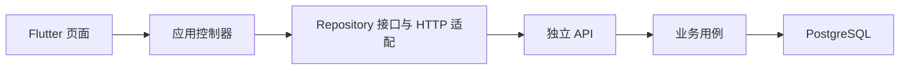

# 双方记事本：接手教程

适用基线：2026-10-05 的 M2 开发版；编写时仓库快照为 `31abd2cc848f4fb6a4be358f3c2329aea077a9ac`。面向第一次接触项目、需要启动和继续开发的同事。

产品做什么：用户与虚构角色的记事本，通过明确分享的日记展开交流。角色、日记、授权、记忆与任务接口已接入，真实模型默认关闭。

**M2 已在 main。模型未配置时生成和发送按钮禁用是当前预期行为，不能用假回复替代服务接入。**

这份文档按“取得代码 → 启动 → 操作 → 理解代码 → 修改并验证”的顺序阅读。[阶段报告](status-report.md)回答做到了哪里，[阶段记录](milestones.md)保存历史证据，本教程回答下一位开发者怎么做。先阅读仓库根目录的 [AGENTS.md](../AGENTS.md)。

## 1. 第一天的接手目标

- 拿到本仓库访问权限，确认分支正确。
- 在自己的电脑启动后端，健康检查返回 ok。
- 在 Android 专用模拟器运行应用，注册自己的测试账户并走完第 4 节。
- 跑完本产品的基础测试；理解第 6 节的一条真实调用链。
- 能说明哪些是已完成的能力，哪些是未验收或待开发事项。

三个产品是独立仓库、独立账户和数据，不需要先安装另外两款。没有统一的根目录启动命令，也没有预置演示账户。仓库是私有的，接手人须由所有者授予 GitHub 访问权限；不要交接个人 GitHub 令牌、数据库口令或真实笔记。

## 2. 准备环境并取得代码

| 工具 | 项目使用的版本/要求 | 检查方式 |
| --- | --- | --- |
| Git | 可访问本私有仓库 | `git --version` |
| Node.js | package.json 要求 >=24.15.0；已验证 24.17.0 | `node --version`、`npm --version` |
| Flutter / Dart | 已验证 Flutter 3.47.6，Dart 3.13.5；先保持锁文件 | `flutter --version` |
| Android | Android Studio/SDK、可用 JDK、SDK 许可及专用模拟器 | `flutter doctor -v`、`flutter devices` |
| PostgreSQL | 开发脚本通过依赖准备 18.4；无需先装全局数据库 | 首次 npm ci / 启动时需能下载依赖 |
| iOS | 后续需要 macOS、Xcode 与开发签名 | 当前 Windows 尚未验收 |

本地已验证的是 API 35 x86_64 / Pixel 5 模拟器；它是验证配置，不是产品最低系统版本的声明。安装 SDK 和构建依赖需要网络；先解决 flutter doctor 中与目标平台相关的问题。PowerShell 如果阻止 npm.ps1，可使用等价的 npm.cmd 命令。

以下示例使用 **Windows PowerShell**，目录 C:\work 可替换为自己有写权限的纯英文真实目录。新机器不要依赖原作者的 Codex 缓存路径、已有模拟器或后台服务。

```powershell
New-Item -ItemType Directory -Force C:\work | Out-Null
Set-Location C:\work
git clone --branch main https://github.com/cn7shi/shared-notebook.git
Set-Location C:\work\shared-notebook
git branch --show-current
git status --short
```

期望分支为 `main`。新检出工作区应无未提交修改；已有同名目录时复用自己的检出，不覆盖或删除它。

## 3. 启动：两个终端，各自保持正确目录

### 终端 A：独立后端

```powershell
Set-Location C:\work\shared-notebook\server
npm ci
npm run dev
```

首次启动会创建 server/.local/postgres.json 和开发数据库目录、生成本机数据库口令、执行迁移，然后提供 API。不要把这些本地文件复制给接手人；他应在自己的电脑创建开发环境。

| 连接项 | 本产品地址 |
| --- | --- |
| 宿主机健康检查 | http://127.0.0.1:3300/health |
| 宿主机接口文档 | http://127.0.0.1:3300/api/docs |
| HTTP API 前缀 | /api/v1 |
| 开发数据库端口 | 54393 |
| Android 模拟器访问宿主机 | http://10.0.2.2:3300 |

用另一个终端检查：

```powershell
Invoke-RestMethod http://127.0.0.1:3300/health
```

期望返回 status 为 ok；接口文档应能打开。保持终端 A 运行，结束开发时在该终端用 Ctrl+C，让 API 和开发数据库正常停止。同一仓库不要重复启动多份开发服务；先确认端口占用来源。

**开发模式不需要先复制 .env。** [dev.ts](../server/scripts/dev.ts) 使用自己的本地数据库设置，API 端口固定为 3300，只监听 127.0.0.1；npm run dev 不加载 .env。修改 .env 中的 PORT / DATABASE_URL 不会改变这条开发启动路径。

### 终端 B：Flutter 应用

先在 Android Studio 启动一个专用模拟器；没有现成 AVD 时，用 Device Manager 创建。然后：

```powershell
Set-Location C:\work\shared-notebook\mobile
flutter pub get --enforce-lockfile
flutter devices
flutter run -d emulator-5554 --dart-define=API_BASE_URL=http://10.0.2.2:3300
```

把 emulator-5554 替换为 flutter devices 显示的实际设备 ID。进入应用后注册自己的开发账户，密码需 12–128 位；应用使用真实 API 和原生存储，不会自动填充示例数据。

API_BASE_URL 是服务根地址，**不要添加 /api/v1**。Android 模拟器中的 127.0.0.1 指向模拟器自身；10.0.2.2 用于访问宿主机。真机/iOS 不能照搬该地址，应使用设备能访问的服务地址；发布模式要求 HTTPS。改地址后需重新构建/启动应用，仅改后端环境不会重写安装包配置。

本教程优先用英文检出路径直接运行 Flutter。现有中文父目录下的 Android 构建，请看第 5 节脚本；目录链接会被 Gradle 解析回原路径，单独改仓库名字不一定解决问题。

## 4. 用自己的测试账户走一遍产品

1. 注册开发账户，创建虚构角色，写一篇私人日记。只保存不应自动分享。
2. 打开分享确认并取消，检查仍未分享；再明确确认分享，留下带来源的记忆。
3. 修改原文并保存，检查旧分享已撤回、来源记忆失效；需要明确重新分享新版本。
4. 从已分享日记进入关联对话。当前模型关闭，发送应禁用，输入仍能留在本机。
5. 返回后再次进入、再强制停止普通应用并冷启动，检查登录和输入恢复。明确撤回分享后，不应因重试旧请求重新授权。

这里列的是交接复验步骤，不代表本次写文档时重新执行了设备测试。此前完整验证范围、失败尝试和安装包来源见 [milestones.md](milestones.md)。

## 5. 怎样验证、构建与安装

先在 server 目录执行后端测试：

```powershell
Set-Location C:\work\shared-notebook\server
npm test
```

该命令先编译 TypeScript，再运行 Node 测试，使用临时真实 PostgreSQL 和 HTTP，正常结束时清理自己的测试集群。不是只验证 Mock。

保持第 3 节的开发 API 运行，再在 mobile 目录执行：

```powershell
Set-Location C:\work\shared-notebook\mobile
flutter analyze
flutter test --dart-define=TEST_API_BASE_URL=http://127.0.0.1:3300
```

宿主机执行的真实 API 测试使用 127.0.0.1，不是模拟器的 10.0.2.2。省略 TEST_API_BASE_URL 会跳过真实 API 用例，不能据此声称完整通过。它会向开发库写入合成账户/记录，清理策略以测试源码为准；不要连接生产服务。

本交接基线：后端 **19/19**，Flutter **21/21**（其中真实 API **5** 项）已通过，Android 完整集成场景 **1/1** 及普通包重开检查已通过。它们是已有证据，后续改动要按影响范围重新验证。GitHub 分别有后端和 Flutter + 真实 API 工作流。Flutter 的可选 SDK 缓存已关闭，原因是收尾阶段全仓哈希失败；验证和测试步骤均保留。

### Windows 构建脚本

从仓库根执行，SDK 路径替换为本机实际安装位置：

```powershell
Set-Location C:\work\shared-notebook
.\scripts\build-android.ps1 -FlutterSdk C:\tools\flutter -AndroidSdk C:\Android\Sdk -ApiBaseUrl http://10.0.2.2:3300
```

[脚本](../scripts/build-android.ps1)把 Git 跟踪或未忽略的 mobile 源码复制到独立英文物理目录，在那里构建，再把普通调试包复制到 mobile/build/app/outputs/flutter-apk/app-debug.apk。旁边的 build-manifest.json 记录源码提交、文件哈希、API 地址、APK 哈希。该包依赖本地 API，不是生产发布包。

可用 `-BuildRoot C:\builds\shared-notebook` 指定可写的纯英文真实目录；不要选目录链接。临时副本保留供排错，不是新的代码仓库，继续开发应改原检出。英文路径也可在 mobile 目录直接执行 `flutter build apk --debug --dart-define=API_BASE_URL=http://10.0.2.2:3300`，但这条命令不生成上述源码校验清单。

要跑设备流程，使用专用且无旧登录状态的测试安装，再执行：

```powershell
Set-Location C:\work\shared-notebook
.\scripts\build-android.ps1 -FlutterSdk C:\tools\flutter -AndroidSdk C:\Android\Sdk -TestDevice emulator-5554
```

这会在设备执行 [android_flow_test.dart](../mobile/integration_test/android_flow_test.dart)，默认结束后卸载测试应用。需要继续检查系统级恢复时追加 `-KeepTestApp`；随后重新构建并安装普通包，因为集成测试入口不同于正常应用入口。只在专用测试安装中清理旧账户/数据，不清除自己正在使用的应用数据。

成功报告为 mobile/build/reports/android-flow.json；失败不会写成功报告。普通包可用本机 Android SDK 的 adb 安装：

```powershell
Set-Location C:\work\shared-notebook
& C:\Android\Sdk\platform-tools\adb.exe -s emulator-5554 install -r .\mobile\build\app\outputs\flutter-apk\app-debug.apk
```

若提示签名不匹配，不要直接卸载含真实数据的应用；先确认是否装错产品、设备或签名。普通包恢复检查应使用同一调试签名和专用账户。

## 6. 代码从哪里读

前后端分别启动，通过 HTTP 协作；同仓存放不等于页面直接操作数据库。



| 阅读顺序 | 文件与职责 | 读完应能回答 |
| --- | --- | --- |
| 1 | [客户端入口](../mobile/lib/main.dart)、[应用装配](../mobile/lib/presentation/app.dart) | 服务地址、存储和登录状态在哪里装配？ |
| 2 | [核心页面](../mobile/lib/presentation/entry_screen.dart) | 哪个用户动作触发写入？哪些只是展示？ |
| 3 | [写入控制器](../mobile/lib/application/work_controller.dart)、[读取控制器](../mobile/lib/application/read_controllers.dart) | 输入、待确认请求、读取状态怎样变化？ |
| 4 | [客户端接口](../mobile/lib/domain/repositories.dart)、[HTTP 适配](../mobile/lib/data/api.dart)、[本机存储](../mobile/lib/data/local_store.dart) | 页面怎样摆脱 HTTP 和数据库实现？ |
| 5 | [服务端装配](../server/src/app.ts)、[HTTP Controller](../server/src/http/controllers.ts)、[输入/输出对象](../server/src/http/dto.ts) | 认证、参数与响应在什么边界处理？ |
| 6 | [业务用例](../server/src/application/notebook.service.ts)、[领域类型](../server/src/domain/notebook.ts) | 哪些业务规则必须由后端保证？ |
| 7 | [PostgreSQL 适配](../server/src/infrastructure/postgres-notebook.ts)、[事务与迁移](../server/src/infrastructure/database.ts)、[初始迁移](../server/migrations/001_initial.sql) | 写入何时提交，失败如何回滚？ |
| 8 | [后端测试](../server/test/api.test.ts)、[客户端测试](../mobile/test/work_controller_test.dart)、[真实 API 测试](../mobile/test/real_api_test.dart) | 恢复和错误分支有什么证据？ |

### 跟一条真实流程读

1. 从 [EntryScreen](../mobile/lib/presentation/entry_screen.dart) 的分享确认进入 [EntryController.share](../mobile/lib/application/read_controllers.dart)。该控制器先完整读取角色与授权分页，读取失败不会当成“未分享”。
2. `Workspace.action` 构建请求，[WorkController.submit](../mobile/lib/application/work_controller.dart) 先落盘原始请求和幂等键，再交给 [HttpNotebookRepository.execute](../mobile/lib/data/api.dart)。
3. `share` 命令映射到逐角色授权接口，再进入 [NotebookController.share](../server/src/http/controllers.ts) 与 [NotebookService.share](../server/src/application/notebook.service.ts)，最终由 [PostgresNotebook](../server/src/infrastructure/postgres-notebook.ts) 在事务内校验、写入。
4. 生成是另一条异步链：消息/日记请求保存任务并返回，随后 [GenerationWorker.start / tick / runOne](../server/src/application/generation.service.ts) 处理数据库任务。它不是 HTTP Controller 直接等待模型回答。
5. [createApp](../server/src/app.ts) 注入同一服务端 Repository 和模型适配器；worker 在事务外调用模型，在发布结果前重新检查上下文版本、任务状态和执行标识。

**不能破坏的规则：** 日记默认私有；分享绑定精确 revision；改写/撤回会让旧授权、来源记忆和旧生成上下文失效；历史对话可读不等于仍可发送到模型。原因见 [ADR-003](decisions/003-mobile-consent-and-recovery.md)。

不要一上来逐文件通读。先跑第 4 节，再按这条链找到对应动作；若中途看不懂，带着文件、符号和具体现象继续提问，避免只背目录。

## 7. 接到一个修改任务，应该改哪里

| 任务 | 起点 | 保留的边界 |
| --- | --- | --- |
| 改布局、颜色、按钮位置 | mobile/lib/presentation | 不把 SQL、HTTP 地址或模型密钥写到页面 |
| 改保存时机、冲突提示或恢复流程 | mobile/lib/application + 对应测试 | 明确区分本机保存、请求已发出与云端确认 |
| 改 API 字段或新增业务动作 | server/src/http + application + 客户端 Repository | 服务端重新验证身份、版本及归属，不只靠前台禁用按钮 |
| 改数据库结构 | server/migrations + infrastructure | 新增有序迁移，不修改已应用文件；保留 SQL 的 LF 换行 |
| 查历史设计理由 | [decisions](decisions) 与 [architecture.md](architecture.md) | 重要新选择同时记录原因、代价和验证 |

修改后先运行与改动相关的检查；涉及接口或核心保存流程，再跑后端、真实 API 与设备场景。改了公开契约，在 server 目录运行 `npm run contract` 更新 contracts/openapi.json 并检查差异。契约来自 DTO/装配，客户端适配器目前是手写的，不会因生成 OpenAPI 自动更新 Dart 文件。

迁移器校验已应用 SQL 文件的哈希；不要用编辑旧迁移或删开发库的方法掩盖升级问题。新接口先部署后端再升级客户端；不承诺新版客户端可以直接使用缺少该能力的旧服务。

提交前查看 `git status --short` 和 `git diff --check`，同步功能/阶段记录及必要 ADR。沿本产品现有分支提交，推送前确认远端和分支，推送后核对提交。不要附带 .env、server/.local、令牌、真实笔记、签名文件或 build 产物。

## 8. 常见卡点

| 现象 | 先确认什么 | 处理方向 |
| --- | --- | --- |
| 克隆提示无权限 | GitHub 账户是否获仓库授权 | 由所有者授予访问权限，不共享个人令牌 |
| npm run dev 找不到脚本/迁移 | 当前是否在本仓库 server 目录 | 回到正确目录；不要从三个仓库的共同父目录运行 |
| API/数据库端口被占用 | 是否已有同一开发服务，或其他程序使用端口 | 先确认所属进程并正常停止；不批量终止 Node/PostgreSQL |
| 手机连不上，电脑能打开文档 | 模拟器地址、端口、后端是否启动 | 模拟器用 10.0.2.2；真机另配可达地址，不能用模拟器地址 |
| 修改 .env 后开发端口没变 | 使用的是 dev.ts 还是 src/main.ts | dev 路径固定端口且不加载 .env；外部数据库模式见第 10 节 |
| Android 报非 ASCII 路径 | 真实父目录是否含中文，是否仅用了链接 | 新检出用英文目录；现有检出用物理副本构建脚本 |
| Flutter 工具异常 | SDK/锁文件版本、真实路径、受限执行环境 | 从正常终端核对 flutter doctor；构建脚本不能修复缺失 SDK 或网络 |
| 构建时下载失败 | 首次 SDK/依赖下载网络及许可 | 核对网络和 Android 工具状态，保留原错误；不要静默换依赖版本 |
| 测试通过但显示跳过 | 是否设置 TEST_API_BASE_URL | 启动本机 API 并按第 5 节运行 |
| App 显示待确认/版本冲突 | 之前的请求是否可能已提交 | 先重试原请求或比较双方内容，不能换键假装新建成功 |
| 登录过期或账户看不到旧草稿 | 账户是否相同，令牌是否失效 | 重登原账户；草稿按账户隔离，三款账户也互不通用 |
| 浏览器访问失败 | 来源地址是否与 CORS 配置匹配 | 开发脚本默认允许 localhost/127.0.0.1 的 8080；原生客户端不靠 CORS 修复网络 |
| 设备测试一开始就失败 | 是否复用了保留登录状态的测试安装，设备是否在线 | 用专用测试环境复原起点；不要固定加 --no-dds 掩盖连接问题 |

记录问题时带上提交、平台、操作步骤、预期/实际现象和错误码；服务端有 requestId 时一并记录。日志和截图中的令牌、密码及真实正文需移除。

## 9. 将来如何接入真实模型

现在没有一个“填入 API Key 就自动启用”的供应商实现，也没有要求先准备模型密钥才能启动的步骤。

1. 先读 [ModelProvider / ModelContext](../server/src/domain/notebook.ts) 与 [DisabledProvider](../server/src/infrastructure/disabled-provider.ts)。接口要求 `id`、`available` 和 `generate(context, signal)`，返回 `{ body }`。
2. 确定供应商后，在 server/src/infrastructure 中新增适配器（待开发），只使用 worker 传入的获准上下文，支持取消/超时。
3. 在 [开发入口](../server/scripts/dev.ts) 和 [正常入口](../server/src/main.ts) 调用 `createApp` 时装配 `provider`。目前两处都未提供该参数，因此使用 DisabledProvider；把密钥放进 .env 并不会自动改变这一点。
4. 密钥只放服务端配置；若开发入口要使用新配置，需显式实现读取，因为当前 npm run dev 不加载 .env。补充 .env.example 的变量名与说明，不提交实际值。
5. 保留 worker 的授权复核和任务状态机，再测撤回时生成、超时、重试与重启。默认无模型的本地测试仍应能运行，不要将测试适配器作为生产供应商。
6. 接入后另外评估质量、费用与多日背景延续，当前 19 项后端测试不能证明这些真实模型效果。

客户端由 capabilities 判断是否可发送/生成；无配置或能力读取失败时不创建新任务，旧请求恢复仍使用原幂等键确认结果。

## 10. 外部数据库、交接边界与下一步

第 3 节已经足够本地开发。只有明确要接独立 PostgreSQL 时，才走下面这条路径；它不是已经验收的生产部署方案：

```powershell
Set-Location C:\work\shared-notebook\server
if (-not (Test-Path -LiteralPath .env)) { Copy-Item -LiteralPath .env.example -Destination .env }
```

自行在本机 .env 填写真实 DATABASE_URL、HOST、PORT 和需要的 CORS_ORIGINS；模板中的 replace-me 不能直接使用。先创建数据库与对应权限，再依次执行：

```powershell
npm run build
npm run migrate
npm start
```

[正常入口](../server/src/main.ts)通过 package.json 的 Node 启动选项读取 .env；迁移要单独执行，不应认为 npm start 会自动完成结构升级。停止第 3 节服务后再使用相同端口。数据库 TLS、API HTTPS、备份恢复、监控和发布流程需另行设计与验收。

接手完成前，请在自己的记录里确认：

- 实际使用的分支/提交、运行环境，以及 health 的结果；
- 第 4 节操作是否成功，出现了哪些失败；
- 后端与 Flutter 的通过/失败/跳过数，设备测试是否完整结束；
- 当前改动影响哪些契约/迁移，文档是否同步；
- 未完成项与下一位负责人的安排，不能只写“全部完成”。

目前仍待 Android 真机中文输入法与厂商后台场景、iOS 构建/签名/设备验证、完整离线同步和生产发布。已有 iOS 工程不代表已经通过 Xcode 构建；当前 Windows 无法完成该验收。辅助 Web 的完整浏览器验收也待开展。具体限制以 [功能清单](features.md) 与 [阶段记录](milestones.md) 为准。

**这份教程本次核验范围：** 已对照仓库入口、脚本、符号与已有验收记录，并检查文档链接和示例语法；没有声称在一台全新电脑或 iOS 设备上重新演练过。
